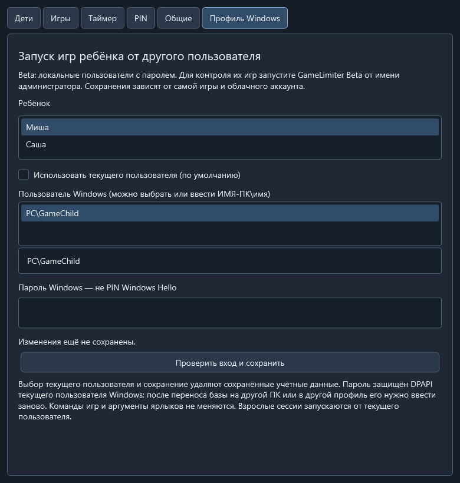
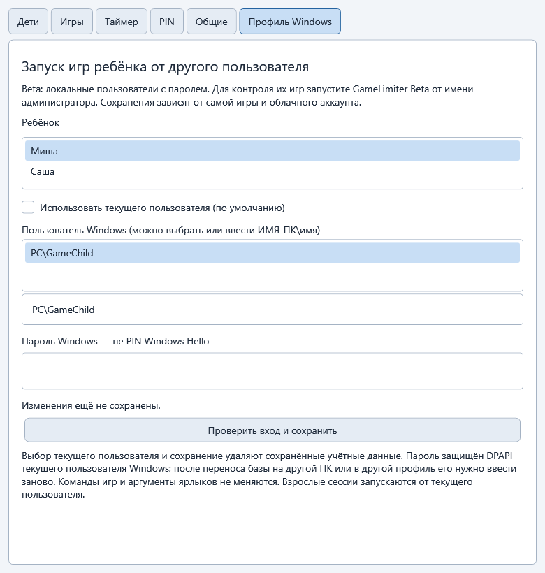
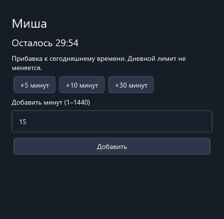
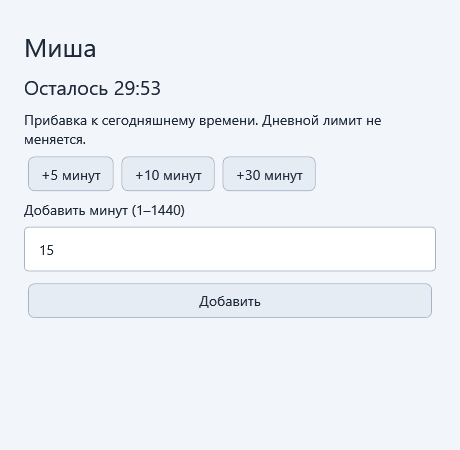
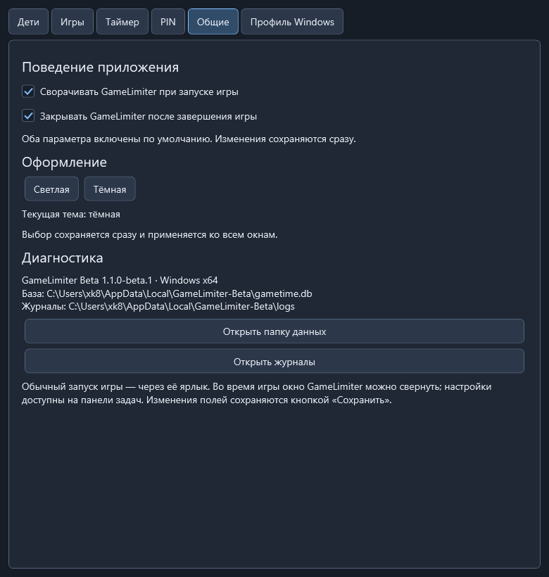

# GameLimiter Beta 1.1.0-beta.1

Тестовая ветка `test/windows-profiles-1.1.0` на базе стабильной версии 1.0.3. Новая функция — запуск игр ребёнка от отдельного локального пользователя Windows с загрузкой его профиля. Прямой запуск и поиск процесса после лаунчера проверены на тестовой программе; совместимость с конкретными играми и облачными сохранениями требует ручной проверки.

## Отдельная тестовая установка

Установщик ставит **GameLimiter Beta** в `%LOCALAPPDATA%\Programs\GameLimiter-Beta`. База и журналы находятся в `%LOCALAPPDATA%\GameLimiter-Beta`. Стабильная версия и её данные не обновляются. Portable использует ту же отдельную beta-базу. Автоматического импорта стабильной базы нет: создайте тестовый PIN, детей и игры.

Одновременно открывать стабильную и beta-версию нельзя: они используют общую блокировку сессии. Перед тестом закройте стабильный лимитер и управляемую игру. Для beta создавайте отдельные ярлыки из её настроек: имена `GameLimiter-Beta-<id>.lnk`, аргументы по-прежнему `--game <id>`; стабильные ярлыки не перезаписываются.

## Настройка профиля Windows

1. Создайте для ребёнка обычную **локальную** учётную запись Windows с непустым паролем. Для этой beta доменные и Microsoft-аккаунты не поддерживаются. Программа не создаёт пользователей сама.
2. Войдите в эту учётную запись хотя бы один раз, настройте нужный лаунчер и доступ к игре. Игровые файлы должны быть доступны этому пользователю. Затем вернитесь в родительскую учётную запись.
3. Откройте **GameLimiter Beta от имени администратора** под тем же пользователем Windows, который будет сохранять пароль. Членство в группе администраторов без повышения прав недостаточно. Также запускайте игровой beta-ярлык от имени администратора.
4. В родительских настройках сначала добавьте и сохраните ребёнка, затем откройте вкладку **Профиль Windows**.
5. Выберите ребёнка, снимите **Использовать текущего пользователя**, выберите локальную учётную запись из списка или введите `ИМЯ-ПК\имя` / `.\имя`.
6. Введите **пароль Windows**, а не PIN Windows Hello. Нажмите **Проверить вход и сохранить**. Windows проверит учётные данные; ошибка не перезапишет ранее сохранённый профиль. Настройка применяется со следующей игровой сессии.
7. Запустите существующую конфигурацию игры через beta-ярлык и выберите ребёнка. Пути, аргументы и команды игры менять не нужно. Windows загрузит профиль выбранного пользователя; сохранения в его профиле будут отдельными.

Чтобы вернуть прежний запуск и удалить сохранённые учётные данные, включите **Использовать текущего пользователя** и сохраните. Взрослые сессии всегда запускаются от текущего пользователя.

Пароль хранится в SQLite только как зашифрованный DPAPI блок, привязанный к родительскому пользователю Windows. Это обратимое шифрование, не хеш. После переноса базы в другой профиль или на другой компьютер введите пароль заново. При смене пароля Windows также сохраните его повторно. Пароль не передаётся в командной строке и не пишется в журнал.





## Ограничения и проверка игры

- Отдельный профиль разделяет сохранения только там, где игра использует пользовательские каталоги. Общая папка игры и облачные сохранения одного игрового аккаунта могут оставаться общими. Существующие сохранения автоматически не переносятся.
- Начните с тестовой игры или отдельного тестового сохранения. Проверьте разные сохранения у двух детей, запуск после перезагрузки, закрытие по таймеру, Alt+Tab и возврат к текущему пользователю.
- Закройте уже работающий лаунчер перед первым тестом. Повторное использование старого игрового процесса не поддерживается. Поиск нового процесса ограничен именем, временем запуска, Windows-сессией и SID выбранного пользователя.
- Игры, лаунчеры и античиты могут иметь собственные ограничения для запуска в другом профиле. Универсальная совместимость не заявляется.
- Нужны работающая служба вторичного входа Windows и право локального интерактивного входа у выбранной учётной записи. Пароль нельзя заменить хешем или Windows Hello PIN.
- Beta-установщик не подписан. Удаление beta не удаляет её данные. Стабильная версия остаётся доступной через прежние ярлыки.

## Проверки сборки

Стандартный `build.ps1` собирает Debug/Release, выполняет тесты, self-contained publish и проверку WPF/SQLite. Нативный тест профиля запускается отдельно и только с явным согласием: `tools/Test-WindowsProfile.ps1 -DotnetPath <полный путь к dotnet.exe>` из повышенного PowerShell. Он создаёт временного локального пользователя, проверяет профиль, DPAPI и завершение процессов, затем удаляет пользователя и профиль. При ошибке очистки проверьте `artifacts/windows-profile-result.txt`.

Документация Windows: [CreateProcessWithLogonW](https://learn.microsoft.com/en-us/windows/win32/api/winbase/nf-winbase-createprocesswithlogonw).


Локальный таймер игр для Windows 11 x64. У каждого ребёнка свой дневной лимит на все игры. Контролируются только игры, запущенные через ярлыки GameLimiter.

## Установка и настройка

Скачайте установщик `GameLimiter-1.1.0-beta.1-win-x64-Setup.exe` из раздела **Releases**. Программа устанавливается для текущего пользователя, .NET уже включён. Перед обновлением завершите игру и закройте GameLimiter.

Для запуска без установки распакуйте **весь** архив `GameLimiter-1.1.0-beta.1-win-x64-Portable.zip` в постоянную папку и запустите `GameLimiter.exe`.

1. При первом запуске создайте родительский PIN из 4–12 цифр.
2. Откройте **Настройки родителя → Дети**, добавьте детей и задайте дневные лимиты в минутах.
3. На вкладке **Игры** добавьте игру: уникальный Id, название и путь к exe. При необходимости задайте аргументы и рабочую папку. Если лаунчер запускает отдельный процесс, укажите имя настоящего игрового процесса, например `actualgame.exe`.
4. Сохраните игру и нажмите **Создать / обновить ярлык**. Можно использовать значок игры или выбрать exe/ico.
5. Закройте GameLimiter и запустите игровой ярлык. Ребёнок выбирает своё имя; игра запускается, если осталось время.

При успешном запуске игры окно GameLimiter автоматически сворачивается, а после завершения игры приложение закрывается само, сохранив использованное время. Настройки доступны по PIN через окно на панели задач. Завершить сессию можно закрытием игры или кнопкой **Завершить текущую игру** с PIN. Если автозакрытие отключено, перед запуском другого игрового ярлыка закройте оставшееся окно GameLimiter. Одновременно поддерживается одна сессия.

На кнопке ребёнка показана понятная подпись: **«Осталось 35 минут»**. Для одной минуты используется «Осталась 1 минута», для неполной последней минуты — «Осталось меньше минуты».

## Добавить время во время игры

Переключитесь в GameLimiter через Alt+Tab или панель задач и нажмите **«◷ + Добавить время»**. Введите родительский PIN, затем выберите **+5, +10, +30 минут** или введите своё количество (1–1440) и нажмите **«Добавить»**. Окно закроется, новый остаток появится в основном окне на следующем обновлении таймера.

Для ребёнка увеличивается только сегодняшняя поправка; базовый дневной лимит не меняется. Для взрослой сессии с таймером продлевается текущая игра. В безлимитной сессии кнопка недоступна. Если после прибавки снова осталось время, отсрочка из-за уменьшения лимита отменяется. После начала закрытия игры продлить сессию уже нельзя.





## Настройки

Все настройки собраны в одном окне: **Дети**, **Игры**, **Таймер**, **PIN**, **Общие**. Редактировать файлы вручную не требуется.

На вкладке **Дети** показаны базовый лимит, сегодняшняя поправка, использованное и оставшееся время. Кнопки прибавления и вычитания минут действуют только сегодня. Своя поправка прибавляется к уже установленной. Если уменьшение исчерпало время текущей игры, ребёнок получает отсрочку — по умолчанию 60 секунд.

В разделе **Общие** есть две независимые галочки: **Сворачивать GameLimiter при запуске игры** и **Закрывать GameLimiter после завершения игры**. Обе включены по умолчанию, в том числе после обновления с 1.0.1; изменения сохраняются сразу. Они действуют и для детских, и для взрослых сессий. При ошибке запуска или учёта окно остаётся открытым с сообщением.

Кнопка **Взрослый** требует PIN и позволяет выбрать ограниченное время или безлимитную сессию без расходования детского лимита.

По умолчанию включена тёмная тема. Выбор светлой или тёмной темы: **Настройки родителя → Общие → Оформление**. Изменение сохраняется сразу.

За 5 минут до конца в правом верхнем углу появляется компактный таймер. За 2 минуты он увеличивается; за минуту становится крупнее и чередует красный и жёлтый цвета. Последние 10 секунд также показываются в углу. **«Время вышло»** появляется по центру, после чего приложение закрывает игру. Пороги предупреждений и ожидание закрытия настраиваются на вкладке **Таймер**.

## Скриншоты

Выбор игрока в тёмной теме:


Дети и дневные лимиты:


Настройка игр и ярлыков:


Общие настройки в тёмной теме:



Светлая тема:


Таймер за пять минут и два цвета последней минуты:


## Сборка из исходников

Требования: Windows 11 x64, .NET 10 SDK и PowerShell. Выполняйте команды из корня проекта:

```powershell
.\build.ps1
```

Скрипт восстанавливает зависимости, собирает Debug и Release, запускает тесты с тестовой игрой, публикует автономное приложение win-x64 и проверяет опубликованное WPF-приложение на отдельной тестовой базе.

Результат: `artifacts/publish/win-x64/GameLimiter.exe`. Для переноса нужна вся папка `win-x64`. Результаты тестов находятся в `artifacts/test-results`, проверочные изображения — в `artifacts/smoke`.

Для сборки установщика установите Inno Setup 6 или 7 и выполните:

```powershell
.\tools\Build-Installer.ps1
```

Скрипт выполнит сборку, тесты и публикацию, затем создаст установщик, переносимый ZIP и `SHA256SUMS.txt` в `artifacts/release`. Версия берётся из `src/GameLimiter.App/GameLimiter.App.csproj`. При нестандартном расположении компилятора передайте путь:

```powershell
.\tools\Build-Installer.ps1 -IsccPath 'C:\Tools\Inno Setup 6\ISCC.exe'
```

## Структура проекта

- `src/GameLimiter.Core` — модели, расчёт времени и валидация.
- `src/GameLimiter.Infrastructure` — SQLite, процессы, сессии, PIN и ярлыки.
- `src/GameLimiter.App` — WPF-интерфейс и оверлей.
- `tests` — автоматические тесты.
- `tools` — сборка установщика, создание значка и тестовая игра.
- `installer` — сценарий установщика.
- `assets` — значок; `docs/images` — скриншоты.

## Данные и ограничения

База находится в `%LOCALAPPDATA%\GameLimiter-Beta\gametime.db`, журналы — в подпапке `logs`. Для резервной копии закройте игру и GameLimiter, затем скопируйте всю папку `%LOCALAPPDATA%\GameLimiter-Beta`. Удаление через установщик сохраняет эти данные.

PIN хранится в виде хеша. Использованное время регулярно сохраняется; после аварии при восстановлении добавляется резерв 15 секунд на возможный несохранённый интервал.

Приложение рассчитано на оконный режим и полноэкранный режим без рамки. Раскладка оверлея проверена для 1080p, 2560×1440 и 4K с масштабированием 100–200%; совместимость с конкретной игрой требует проверки. Эксклюзивный полноэкранный режим и игры с правами администратора могут мешать показу таймера или закрытию игры.

Это домашняя утилита, а не защита от намеренного обхода: запуск игры напрямую, завершение таймера через диспетчер задач и изменение часов не блокируются. Лаунчеры, использующие уже работающий игровой процесс, не поддерживаются. Не запускайте одновременно другую копию игры с тем же именем процесса.
