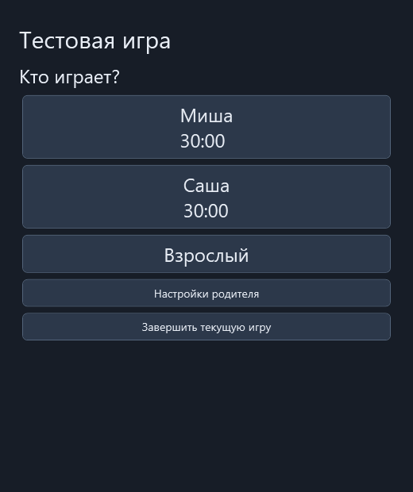
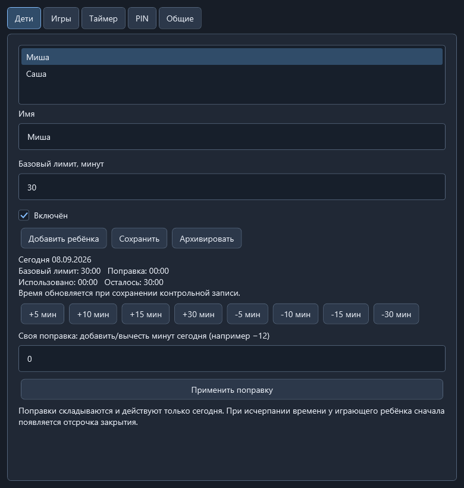
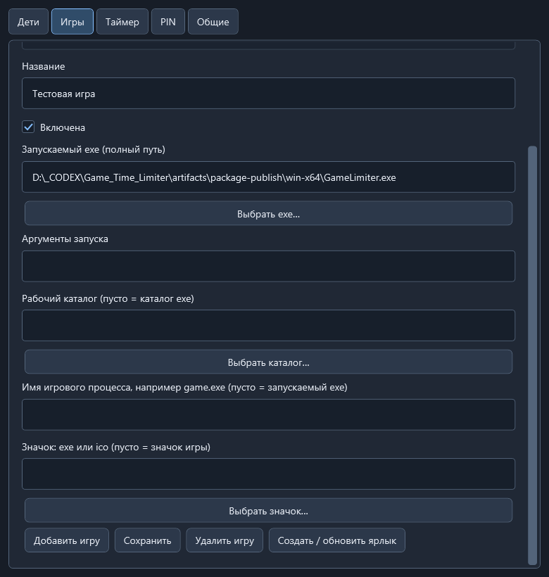
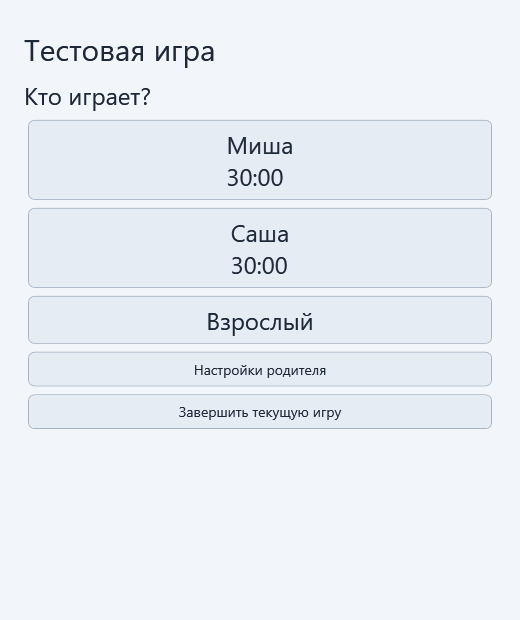

# GameLimiter


Локальный таймер игр для Windows 11 x64. У каждого ребёнка свой дневной лимит на все игры. Контролируются только игры, запущенные через ярлыки GameLimiter.

## Установка и настройка

Скачайте установщик `GameLimiter-1.0.1-win-x64-Setup.exe` из раздела **Releases**. Программа устанавливается для текущего пользователя, .NET уже включён. Перед обновлением завершите игру и закройте GameLimiter.

Для запуска без установки распакуйте **весь** архив `GameLimiter-1.0.1-win-x64-Portable.zip` в постоянную папку и запустите `GameLimiter.exe`.

1. При первом запуске создайте родительский PIN из 4–12 цифр.
2. Откройте **Настройки родителя → Дети**, добавьте детей и задайте дневные лимиты в минутах.
3. На вкладке **Игры** добавьте игру: уникальный Id, название и путь к exe. При необходимости задайте аргументы и рабочую папку. Если лаунчер запускает отдельный процесс, укажите имя настоящего игрового процесса, например `actualgame.exe`.
4. Сохраните игру и нажмите **Создать / обновить ярлык**. Можно использовать значок игры или выбрать exe/ico.
5. Закройте GameLimiter и запустите игровой ярлык. Ребёнок выбирает своё имя; игра запускается, если осталось время.

Во время игры приложение можно свернуть. Настройки доступны по PIN через окно на панели задач. Завершить сессию можно закрытием игры или кнопкой **Завершить текущую игру** с PIN. Перед запуском другого игрового ярлыка закройте оставшееся окно GameLimiter. Одновременно поддерживается одна сессия.

## Настройки

Все настройки собраны в одном окне: **Дети**, **Игры**, **Таймер**, **PIN**, **Общие**. Редактировать файлы вручную не требуется.

На вкладке **Дети** показаны базовый лимит, сегодняшняя поправка, использованное и оставшееся время. Кнопки прибавления и вычитания минут действуют только сегодня. Своя поправка прибавляется к уже установленной. Если уменьшение исчерпало время текущей игры, ребёнок получает отсрочку — по умолчанию 60 секунд.

Кнопка **Взрослый** требует PIN и позволяет выбрать ограниченное время или безлимитную сессию без расходования детского лимита.

По умолчанию включена тёмная тема. Выбор светлой или тёмной темы: **Настройки родителя → Общие → Оформление**. Изменение сохраняется сразу.

За 5 минут до конца в правом верхнем углу появляется компактный таймер. За 2 минуты он увеличивается; за минуту становится крупнее и чередует красный и жёлтый цвета. Последние 10 секунд также показываются в углу. **«Время вышло»** появляется по центру, после чего приложение закрывает игру. Пороги предупреждений и ожидание закрытия настраиваются на вкладке **Таймер**.

## Скриншоты

Выбор игрока в тёмной теме:



Дети и дневные лимиты:



Настройка игр и ярлыков:



Светлая тема:



Таймер за пять минут и два цвета последней минуты:


## Сборка из исходников

Требования: Windows 11 x64, .NET 10 SDK и PowerShell. Выполняйте команды из корня проекта:

```powershell
.\build.ps1
```

Скрипт восстанавливает зависимости, собирает Debug и Release, запускает тесты с тестовой игрой, публикует автономное приложение win-x64 и проверяет опубликованное WPF-приложение на отдельной тестовой базе.

Результат: `artifacts/publish/win-x64/GameLimiter.exe`. Для переноса нужна вся папка `win-x64`. Результаты тестов находятся в `artifacts/test-results`, проверочные изображения — в `artifacts/smoke`.

Для сборки установщика установите Inno Setup 6 или 7 и выполните:

```powershell
.\tools\Build-Installer.ps1
```

Скрипт выполнит сборку, тесты и публикацию, затем создаст установщик, переносимый ZIP и `SHA256SUMS.txt` в `artifacts/release`. Версия берётся из `src/GameLimiter.App/GameLimiter.App.csproj`. При нестандартном расположении компилятора передайте путь:

```powershell
.\tools\Build-Installer.ps1 -IsccPath 'C:\Tools\Inno Setup 6\ISCC.exe'
```

## Структура проекта

- `src/GameLimiter.Core` — модели, расчёт времени и валидация.
- `src/GameLimiter.Infrastructure` — SQLite, процессы, сессии, PIN и ярлыки.
- `src/GameLimiter.App` — WPF-интерфейс и оверлей.
- `tests` — автоматические тесты.
- `tools` — сборка установщика, создание значка и тестовая игра.
- `installer` — сценарий установщика.
- `assets` — значок; `docs/images` — скриншоты.

## Данные и ограничения

База находится в `%LOCALAPPDATA%\GameLimiter\gametime.db`, журналы — в подпапке `logs`. Для резервной копии закройте игру и GameLimiter, затем скопируйте всю папку `%LOCALAPPDATA%\GameLimiter`. Удаление через установщик сохраняет эти данные.

PIN хранится в виде хеша. Использованное время регулярно сохраняется; после аварии при восстановлении добавляется резерв 15 секунд на возможный несохранённый интервал.

Приложение рассчитано на оконный режим и полноэкранный режим без рамки. Раскладка оверлея проверена для 1080p, 2560×1440 и 4K с масштабированием 100–200%; совместимость с конкретной игрой требует проверки. Эксклюзивный полноэкранный режим и игры с правами администратора могут мешать показу таймера или закрытию игры.

Это домашняя утилита, а не защита от намеренного обхода: запуск игры напрямую, завершение таймера через диспетчер задач и изменение часов не блокируются. Лаунчеры, использующие уже работающий игровой процесс, не поддерживаются. Не запускайте одновременно другую копию игры с тем же именем процесса.
